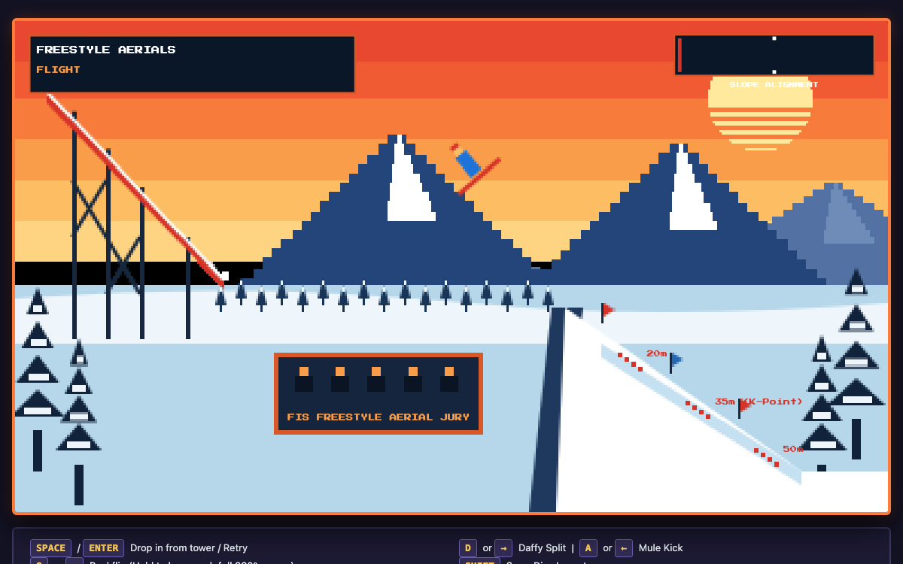
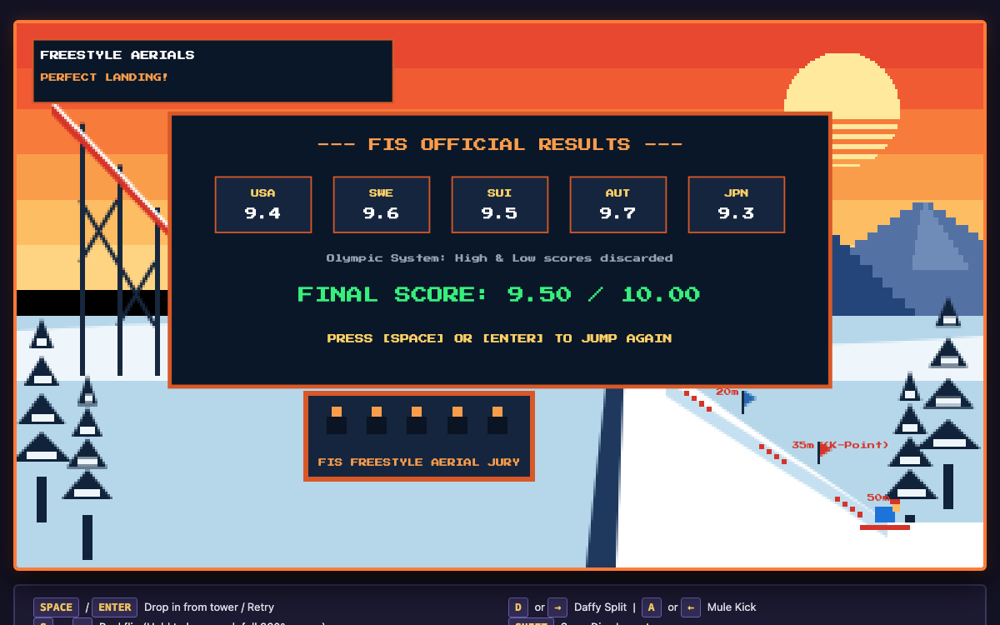

# Freestyle Aerials

> Precision-timed winter acrobatic skiing simulation running entirely in zero-dependency HTML5 Canvas and WebGL engines.

Freestyle Aerials brings the speed, aerial acrobatics, and high-stakes judging of Olympic freestyle aerial skiing directly to the browser. Launch from an in-run tower, execute multi-rotation flips and grab combinations mid-air, align your descent against a 35° mountain gradient, and submit your run to a five-nation international jury.

Available in two distinct, zero-dependency implementations: an authentic **Dual-Canvas 2D Edition** and a hardware-accelerated **WebGL GPU Shader Edition**.

---

[](https://unamatasanatarai.github.io/ski-acrobat/)
[](LICENSE)
[]()
[]()

### 🎮 Play Now

* 🌐 **[Live GitHub Pages Arcade Portal](https://unamatasanatarai.github.io/ski-acrobat/)** — Interactive browser hub featuring both games, descriptions, and inline playable viewport ([`index.html`](index.html))
* 🎨 **[Play Canvas 2D Edition](https://unamatasanatarai.github.io/ski-acrobat/ski-acrobat.html)** — Dual-canvas retro pixel-art edition ([`ski-acrobat.html`](ski-acrobat.html))
* ⚡ **[Play WebGL GPU Edition](https://unamatasanatarai.github.io/ski-acrobat/ski-acrobat-gl.html)** — Hardware-accelerated shader batch edition ([`ski-acrobat-gl.html`](ski-acrobat-gl.html))

---

## Gameplay Previews

| Mid-Air Stunt & Slope Alignment HUD | Official FIS Olympic Scoreboard |
| :---: | :---: |
|  |  |
| *Real-time slope alignment needle guiding touchdown angle* | *5-nation jury evaluation with high/low scores discarded* |

---

## Two Engineered Implementations

Both editions share the exact same deterministic 120Hz physics simulation and competition scoring rules, but are built around two distinct graphics architectures:

### 1. Classic Canvas 2D Edition (`ski-acrobat.html`)
* **Dual-Layer Canvas Compositing**: Uses an internal `384×216` pixelated canvas (`#screen`) for the retro sunset mountain scenery, paired with a subpixel `1920×1080` dynamic canvas (`#ui-screen`) that automatically scales to the host display's `devicePixelRatio`.
* **Zero Runtime Memory Allocations**: Static elements (mountains, trees, ramp scaffolding, jury booth) are pre-rendered into an offscreen buffer at startup and composited in a single `drawImage` pass per frame.
* **Energy-Efficient Sleep Cycle**: The 120Hz accumulator sleeps when idle at the gate or after scoring, waking immediately upon user input.
* **Play**: [Play Live Canvas 2D](https://unamatasanatarai.github.io/ski-acrobat/ski-acrobat.html) | [Source File](ski-acrobat.html)

### 2. WebGL GPU Shader Edition (`ski-acrobat-gl.html`)
* **Unified Hardware-Accelerated Pipeline**: A single WebGL context (`#screen`) powered by custom vertex and fragment shaders.
* **Font Atlas & Geometry Batching**: Dynamically generates an alpha font atlas texture on load; solid geometry and text strings are batched into a single vertex array and rendered in single GPU draw calls.
* **High-Refresh Display Performance**: Designed for high frame stability on 120Hz, 144Hz, and ProMotion displays.
* **Play**: [Play Live WebGL](https://unamatasanatarai.github.io/ski-acrobat/ski-acrobat-gl.html) | [Source File](ski-acrobat-gl.html)

---

## Key Capabilities

### 120Hz Deterministic Flight Physics
A decoupled fixed-timestep physics loop running at 120Hz guarantees consistent jump arcs, rotational acceleration, and ground collision regardless of monitor refresh rates. When motion halts, the loop automatically sleeps to conserve CPU resources until input wakes it.

### Multi-Axis Stunt Engine
String together continuous flips and axial rotations simultaneously:
* **Loops**: Continuous Backflips and Frontflips scoring per complete 360° cycle.
* **Spins**: 360° Pirouette axial twists with automatic landing unwind assists.
* **Pose Stunts**: Daffy Splits, Mule Kicks, and Swan Dive layouts scored on continuous hold time.
* **Hybrid Combinations**: Perform simultaneous rotational combos such as Backflip-Twists.

### Real-Time Slope Alignment Telemetry
A dedicated HUD alignment meter measures the angular offset between your skis and the 34.7° landing hill. Color-coded markers guide micro-adjustments in mid-flight to ensure you touch down within the critical ±0.52 radian landing envelope.

### Olympic FIS Scoring System
A five-member international jury (USA, Sweden, Switzerland, Austria, Japan) evaluates each run:
* Base difficulty ratings calculated per trick.
* Repeat decay multipliers applied to redundant moves.
* Bonus multipliers awarded for clean and perfect touchdown angles.
* Highest and lowest scores discarded, averaging the middle three marks out of 10.00.

### Dynamic Crash & Particle Dynamics
Imperfect landings, unfinished stunts, or over-rotations trigger a ragdoll crash state. Skis detach and tumble down the slope with realistic restitution and friction, accompanied by procedural snow spray bursts.

### Responsive Dual-Input Interface
Play seamlessly across devices:
* Full keyboard mapping with arrow keys, WASD, and action modifiers.
* Automatic touch control layout with pointer capture for tablets and mobile devices.

---

## How It Works

```text
1. GATE DROP      Launch down the in-run ramp from the starting gate
2. KICKER LAUNCH  Leave the ramp lip at 55 px/s horizontal and -105 px/s vertical velocity
3. AERIAL TRICKS  Loop flips, hold grabs, and spin axial pirouettes while airborne
4. ALIGNMENT      Center the HUD needle into the green zone before touching the slope
5. SCOREBOARD     Review individual scores from all 5 international judges
```

---

## Architecture Comparison

| Feature | Canvas 2D (`ski-acrobat.html`) | WebGL GPU (`ski-acrobat-gl.html`) |
| :--- | :--- | :--- |
| **Rendering Backend** | HTML5 Canvas 2D API | WebGL 1.0 (Hardware Shaders) |
| **Layering Model** | Dual canvas (384×216 world + 1920×1080 UI) | Single canvas with unified batching |
| **Text Rendering** | Canvas 2D subpixel `fillText` | Dynamic 2D-generated font texture atlas |
| **Shader Pipeline** | Browser 2D context rasterizer | Custom GLSL vertex & fragment shaders |
| **Ideal Environment** | Universal fallback & low-power devices | High-refresh desktop & mobile displays |
| **Dependencies** | 0 (Pure Web Standards) | 0 (Pure Web Standards) |

---

## Controls

### Keyboard Controls

| Action | Primary Key | Secondary Key | Description |
| :--- | :--- | :--- | :--- |
| **Drop In / Retry** | `Space` | `Enter` | Launch from the starting gate or restart run |
| **Backflip** | `S` | `↓` (Down Arrow) | Hold to loop backflips (360° per score) |
| **Frontflip** | `W` | `↑` (Up Arrow) | Hold to loop frontflips (360° per score) |
| **Pirouette Twist** | `J` | `Z` / `X` | 360° axial spin (combines with flips) |
| **Daffy Split** | `D` | `→` (Right Arrow) | Hold 0.4s to lock in stunt |
| **Mule Kick** | `A` | `←` (Left Arrow) | Hold 0.4s to lock in stunt |
| **Swan Dive** | `Shift` (Left/Right) | — | Hold 0.4s to lock in stunt |

> **Pro Tip**: Release all stunt keys before touchdown to return to a neutral tuck. Touch down with the HUD alignment needle in the green zone to achieve a **PERFECT LANDING** bonus.

### Touch Controls
On touch-enabled devices, on-screen action pads automatically appear below the arena, offering dedicated tap targets for drop-in, flips, twists, daffy splits, mule kicks, and swan dives.

---

## Quick Start & Local Play

Freestyle Aerials requires no package manager, compiler, or HTTP server.

1. Clone or download the repository:
   ```bash
   git clone https://github.com/UnamataSanatarai/ski-acrobat.git
   cd ski-acrobat
   ```

2. Open the arcade hub or standalone game editions directly in your browser:
   * **Arcade Portal (Both Games & Interactive Viewport)**:
     ```bash
     open index.html
     ```
   * **Canvas 2D Edition**:
     ```bash
     open ski-acrobat.html
     ```
   * **WebGL Shader Edition**:
     ```bash
     open ski-acrobat-gl.html
     ```

---

## Live Deployment & GitHub Pages

The repository is built for out-of-the-box hosting on GitHub Pages:

* **Live URL**: **`https://unamatasanatarai.github.io/ski-acrobat/`**
* **Deployment Setup**: Enable GitHub Pages in your repository settings pointing to the root directory `/ (root)` of your default branch (`main` or `master`). [`index.html`](index.html) serves as the primary portal with relative links to all game editions and assets.
* **Alternative Static Hosting**: Deploy directly to Cloudflare Pages, Vercel, Netlify, AWS S3, or Nginx with zero build configuration.

---

## License

This project is licensed under the [MIT License](LICENSE).
